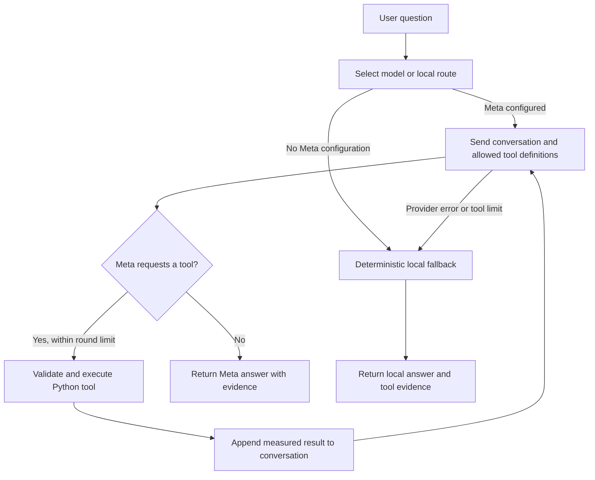

# Adaptive Traffic Signal Coordination Prototype

## What this service is for

This project is a local decision-support prototype for studying coordinated traffic signals on a real Korean road map. It combines OpenStreetMap (OSM) roads and junctions, Korean government intersection reference data, SUMO traffic simulation, and a joint reinforcement-learning controller. The Streamlit dashboard guides a user through choosing a study area and traffic scenario, running a simulation, and comparing the proposed controller with a SUMO fixed-time reference.

The city-scale controller's primary learning objective is **network throughput**, measured as completed trips per simulated hour. Queue length, waiting time, and trip time are additional checks. Generated routes and scenario demand are synthetic or assumption-based unless explicitly identified as imported observations. This is a research prototype: it does not control roadside equipment, submit timing changes to a government system, or establish real-world performance.

The current default is a Seoul test area around Jongno-gu. The city selector is driven by `config/korean_regions.json`; availability of government records can vary by city. OSM roads, junction candidates, and potential traffic generators are displayed on the map. Generator importance is a map-category estimate, not a measured traffic count.

## Install on Windows

### 1. Install Python

Install Python 3.11 or later and make sure the Python launcher (`py`) is available in PowerShell. The reinforcement-learning dependencies include PyTorch through Stable-Baselines3, so a working virtual environment and internet access are required during installation.

### 2. Install SUMO

Install Eclipse SUMO using the [official SUMO download instructions](https://sumo.dlr.de/docs/Downloads.php). The dashboard's simulations use the command-line `sumo` program. `sumo-gui` is optional and is only needed to open a simulation visually. The SUMO installation must include its `tools` directory, which contains TraCI and `sumolib`.

Find the SUMO installation directory. On many Windows installations it is similar to `C:\Program Files (x86)\Eclipse\Sumo` or `C:\Program Files (x86)\SUMO`; use the directory that actually contains `tools` and `bin`. Add that directory to `SUMO_HOME` in `.env` (see below). You may also add SUMO's `bin` directory to Windows `PATH`. `SUMO_BINARY` and `SUMO_GUI_BINARY` can be set to explicit executable paths when SUMO is not on `PATH`.

### 3. Create the Python environment and install dependencies

Open PowerShell in the project directory (`E:\Samsung\TrafficFlow` in the current setup):

```powershell
py -3.11 -m venv .venv
.\.venv\Scripts\Activate.ps1
python -m pip install --upgrade pip
python -m pip install -r requirements.txt
```

If PowerShell blocks virtual-environment activation, allow scripts for the current terminal only, then activate again:

```powershell
Set-ExecutionPolicy -Scope Process -ExecutionPolicy Bypass
.\.venv\Scripts\Activate.ps1
```

Copy the example environment file if `.env` does not already exist. Preserve an existing `.env` so that local credentials and SUMO paths are not overwritten:

```powershell
if (-not (Test-Path .env)) { Copy-Item .env.example .env }
```

Open `.env` in a text editor and fill in the settings you use. Keep `.env` private; it is ignored by Git. Never paste API keys into source files or commit them.

| Variable | Required? | What to put there |
| --- | --- | --- |
| `SUMO_HOME` | Required for SUMO runs | Full path to the SUMO installation directory that contains `tools` and `bin`. |
| `SUMO_BINARY` | Optional | Full path to `sumo.exe` if `sumo` is not found on `PATH` or under `SUMO_HOME\bin`. |
| `SUMO_GUI_BINARY` | Optional | Full path to `sumo-gui.exe` if you want to open visual SUMO runs. |
| `DATA_GO_KR_API_ROOT` | Optional | Government API root. Normally leave as `https://apis.data.go.kr/1320000/CrossRoadInfoService`. |
| `DATA_GO_KR_SERVICE_KEY` | Needed to refresh government intersection data | Your data.go.kr service key. Do not include the API endpoint path. |
| `SEOUL_TDATA_API_KEY` | Needed to fetch Seoul road speeds | Your Seoul T-Data key for dataset 1015. |
| `AGENT_PROVIDER` | Optional | Set to `meta` to enable the Meta model when credentials are configured. |
| `MODEL_API_KEY` | Optional | Meta Model API bearer key. `META_API_KEY` is also accepted as a fallback name. |
| `META_MODEL` | Optional | Exact model identifier enabled for your Meta API account. |

Example format (replace paths and key placeholders with your own values):

```dotenv
SUMO_HOME=C:\\Program Files (x86)\\Eclipse\\Sumo
SUMO_BINARY=
SUMO_GUI_BINARY=
DATA_GO_KR_API_ROOT=https://apis.data.go.kr/1320000/CrossRoadInfoService
DATA_GO_KR_SERVICE_KEY=your_data_go_kr_service_key
SEOUL_TDATA_API_KEY=your_seoul_tdata_key
AGENT_PROVIDER=meta
MODEL_API_KEY=your_meta_model_api_key
META_MODEL=your_account_model_identifier
```

The Meta model is optional. The dashboard's SUMO simulation and PPO functions do not require Meta credentials. The public signal-plan JSON API also needs no API key.

### 4. Check the local setup

With the virtual environment activated, run:

```powershell
python scripts/setup_check.py
```

Confirm that Python, SUMO, `SUMO_HOME`, TraCI, and `sumolib` are found. A missing government or Meta key does not prevent a local SUMO simulation; those integrations will be unavailable until configured.

## Run the dashboard

From the project root, with `.venv` activated:

```powershell
python -m streamlit run scripts/dashboard.py
```

Streamlit prints a local address, usually `http://localhost:8501`, and normally opens it in your browser. Keep the terminal running while you use the dashboard. Stop it with `Ctrl+C`.

### First use

1. Open **New simulation** in the left navigation.
2. Choose a city and synchronize its local map and government intersection data. This first download requires internet access, OSMnx/Overpass availability, and `DATA_GO_KR_SERVICE_KEY` for official intersection records. Existing downloaded data is cached locally; refresh is explicit.
3. Describe the situation or use a suggested commute, quiet-traffic, or event scenario. Select the date, time period, study radius, and simulation duration.
4. Review the demand estimate and its assumptions. When T-Data speeds are used, the speed-based conversion is an estimate and not a measured local vehicle count.
5. Run the SUMO simulation. Train a city PPO policy when needed, then evaluate it against the fixed-time reference using the same route demand. Training takes longer than a normal simulation and benefits from more than the short demonstration timestep count.
6. Open **Simulation results** to review the fixed-time/adaptive comparison, throughput, queues, travel times, signal table, map visualization, and generated report. The proposed plan can be downloaded in the government-shaped JSON envelope described below.

Saved maps, routes, simulation output, model files, and reports are under `data/`, `experiments/results/`, `aatc/rl/models/`, and `reports/`. Do not delete these folders if you need to retain local results or cached inputs.

## Reinforcement learning and simulation

SUMO runs a microscopic road-traffic simulation over an OSM-derived network. `randomTrips.py` generates trips for the chosen scenario. The fixed-time reference uses a SUMO signal program generated for the network; it is not automatically the timing plan returned by the government reference API. The coordinated PPO controller chooses hold/switch decisions jointly across the selected signals. SUMO's configured yellow/all-red clearance intervals and minimum/maximum green safeguards constrain those decisions.

The city reward is configured in `config/city_reward_config.json`. Each newly completed trip earns the main positive reward. Normalized network queue and waiting costs are deliberately smaller secondary terms; invalid actions and unnecessary switching are penalized. The dashboard and report show throughput as `completed_vehicles / simulated_hours`. Vehicles still on the road at the end are not counted as completed. This favors progress through the modeled network, but it does not equal the number of cars entering a real intersection or a sensor-measured city traffic count.

For command-line training and evaluation, from an activated environment:

```powershell
python scripts/train_city_rl.py --city Seoul --datetime 2026-11-02T08:00 --duration 900 --radius-km 1.5 --timesteps 2048 --seed 42
python scripts/evaluate_city_rl.py --model aatc/rl/models/city_L01_1p5km_ppo_42.zip --city Seoul --datetime 2026-11-02T08:00 --duration 900 --radius-km 1.5 --seed 42
```

Use the model path printed by the training command; its name depends on selected settings. A city model is tied to its training city and subnetwork radius. Training creates randomized routes for episodes; evaluation compares fixed-time and PPO with paired scenario demand. The example `2048` steps is intended as a short smoke demonstration, not enough evidence of a converged or operationally optimal policy. Compare multiple seeds, dates, and demand levels before drawing conclusions.

## External data and APIs this project requests

| Source | What the service requests or uses | Credential |
| --- | --- | --- |
| OpenStreetMap through OSMnx and the Overpass API | Drivable road graphs, junction candidates, and selected potential traffic generators for the configured study-area place. OSMnx may also use the OSM geocoding service to resolve a place name. Responses are cached under `data/cities/`. | No project API key. Public service availability and fair-use limits apply. |
| Korean Police Agency CrossRoadInfoService at `https://apis.data.go.kr/1320000/CrossRoadInfoService` | `GET /getCrossRoadInfoList` and `GET /getCrossRoadInfoDetail`, with the selected Korean city/region code, paging, JSON response type, and service key. These supply intersection and signal reference records; they are not used as an executable SUMO timing schedule. | `DATA_GO_KR_SERVICE_KEY`; optional root override: `DATA_GO_KR_API_ROOT`. |
| Seoul T-Data, dataset 1015 | An optional helper can request HTTPS data from `https://t-data.seoul.go.kr/apig/apiman-gateway/tapi/TopisIccStTimesLinkTrfSectionStats/1.0` for a selected date. The current guided dashboard does not call this helper. | `SEOUL_TDATA_API_KEY` only if calling the helper directly. |
| Meta Model API | `POST https://api.meta.ai/v1/chat/completions` for the optional traffic assistant and report narrative. | `MODEL_API_KEY` (or `META_API_KEY`) and `META_MODEL`. |
| Korean holiday calendar | The Python `holidays` package supplies holiday dates used by the local scenario calendar. Local event data and rules provide additional date/time demand multipliers. | No API key. |

Requests to OSM and government data require internet access. The application does not query these sources continuously: map/government sync is user-triggered and cached. T-Data dataset 1015 contains speed, not volume. Its client and speed-based estimator remain in `aatc/city_data/real_traffic.py` for explicit Python use, but the current guided dashboard does not expose them. Imported Smart Intersection volume CSVs can be analyzed with `scripts/import_seoul_traffic.py`; current SUMO demand and PPO training are not calibrated automatically from those counts.

## API this project serves

The project includes a separate, read-only HTTP API for retrieving a saved simulated traffic-signal proposal. Start it in a second PowerShell terminal from the project root:

```powershell
.\.venv\Scripts\Activate.ps1
python scripts/signal_plan_api.py
```

By default it listens only on `127.0.0.1:8080`. Available routes:

| Method and path | Purpose |
| --- | --- |
| `GET /health` or `GET /api/v1/health` | Health response. |
| `GET /api/v1/cities/{city}/signal-plans/latest` | Latest saved comparison for a city, for example `/api/v1/cities/seoul/signal-plans/latest`. |
| `GET /api/v1/cities/{city}/signal-plans/{run_id}` | Proposal for a specific saved run ID. |

Example request:

```powershell
Invoke-RestMethod http://127.0.0.1:8080/api/v1/cities/seoul/signal-plans/latest
```

The successful response is JSON in the public service-style `response.header` / `response.body.items.item` envelope. Items retain government field names where available and include a `SIMULATION_PLAN` extension for the proposed time-based SUMO signal schedule. The JSON contains run/scenario metadata and limitations; missing official intersection mappings remain explicit. The API reads saved files and does not run SUMO on demand, modify a government system, or claim that the receiving public service accepts this schema. There is no authentication in this prototype. It binds to localhost by default; only change `--host` for a controlled network deployment.

## What Meta AI and LangGraph do

The optional Meta-backed traffic assistant is a bounded agent workflow. LangGraph coordinates the steps; Meta supplies natural-language interpretation and response generation. LangGraph itself is not an AI model and does not simulate traffic.

The agent graph is implemented in `aatc/agent/workflow.py` and is invoked by `TrafficAgent.ask()`:



1. **Route the request.** The graph starts each request with a fresh state containing the question and message history. It selects Meta mode when the configured provider, API key, and model are available. Otherwise, it selects the local fallback.
2. **Ask Meta to interpret and plan.** In Meta mode the provider sends the system prompt, current messages, and allowlisted tool schemas to the Meta Chat Completions endpoint. Meta may answer directly or request a tool by name with JSON arguments. The model can interpret the user's intent, choose among available analysis/simulation tools, and explain returned data; it does not have direct TraCI access.
3. **Validate and run requested tools.** `execute_tools` parses the model's arguments and sends them to `TrafficAgentTools.execute()`. The registry only exposes explicitly listed operations, validates their allowed names/arguments, and calls project Python code. Tools can run SUMO scenarios, compare controllers, evaluate a saved city PPO policy, optimize bounded timing candidates, generate demand scenarios, inspect saved runs, project queues from saved samples, or explain a recorded transition. SUMO and its safety checks perform the actual traffic simulation and signal decisions.
4. **Give evidence back to Meta.** Each tool result is appended to the conversation as structured JSON. The graph calls Meta again so it can explain the measured output. Multiple tool rounds are allowed, bounded by `max_tool_rounds` in `config/agent.json` (currently 4). The graph returns the answer, tool calls/results, and evidence used.
5. **Fall back safely.** If Meta is not configured, or a provider error/tool-round limit occurs and `fallback_to_local` is enabled, a deterministic intent matcher chooses from the same Python tools. That fallback is not another LLM and does not provide model reasoning. The response identifies whether `meta` or `local_tools` handled it.

The workflow does not expose a live-signal write tool. Model-generated arguments cannot bypass the tool allowlist or the SUMO safety controller. Tool results are experiment outputs, not instructions to roadside controllers. The request state is not a persistent chat memory between application requests.

The city demand estimator is a second, separate LangGraph graph in `aatc/city_data/demand_workflow.py`. Its nodes read passenger-road lane-kilometers from the selected SUMO network and calculate an expected number of trip departures from insertion density, scenario multiplier, and duration. It is deterministic arithmetic; it does not call Meta. The executive report may make a separate optional Meta request for narrative text; exact comparison values remain built from the saved SUMO metrics.

To check Meta connectivity after setting `.env`, run:

```powershell
python scripts/check_meta_api.py
```

Meta account access, model availability, rate limits, or network connectivity can affect this optional feature. The rest of the dashboard remains usable without it.

## Project layout

- `scripts/dashboard.py` — Streamlit dashboard.
- `scripts/signal_plan_api.py` — read-only simulated signal-plan HTTP API.
- `scripts/run_city_simulation.py`, `scripts/train_city_rl.py`, `scripts/evaluate_city_rl.py` — city SUMO and PPO commands.
- `aatc/city_data/` — OSM/government sync, scenario demand, SUMO city network, PPO, demand calculation, reports, and public JSON serialization.
- `aatc/agent/` — Meta adapter, LangGraph workflow, prompts, allowlisted tools, and local fallback.
- `config/` — city, agent, RL, signal reward, and scenario configuration.
- `data/cities/` — cached map and government data.
- `experiments/results/` — saved SUMO runs, comparisons, and reports.
- `.env.example` — safe template; `.env` — private local settings, not for source control.

## Data quality and limitations

- OSM is a road-map source, not a verified inventory of all live traffic signals. Government records are fetched separately and matched to map junctions conservatively by location.
- The government API's intersection and movement reference fields are not automatically translated to verified signal timings in SUMO. SUMO network programs are generated for simulation.
- Generated trips, default insertion rates, road-speed conversions, and date/event adjustments are model assumptions unless a data source is explicitly shown. Speed is not vehicle volume.
- A completed-trip rate is a useful network-flow proxy inside the selected simulation. A larger number does not by itself establish better real-world operation; inspect queue, waiting, travel time, and junction-level changes too.
- Results cover only the selected map boundary, routes, demand, run length, and random seed. They are not citywide forecasts, field measurements, or an approved recurring signal schedule.
- OSM data is available under the [OpenStreetMap copyright and ODbL terms](https://www.openstreetmap.org/copyright). Government and Seoul data use remain subject to their publishers' terms.
