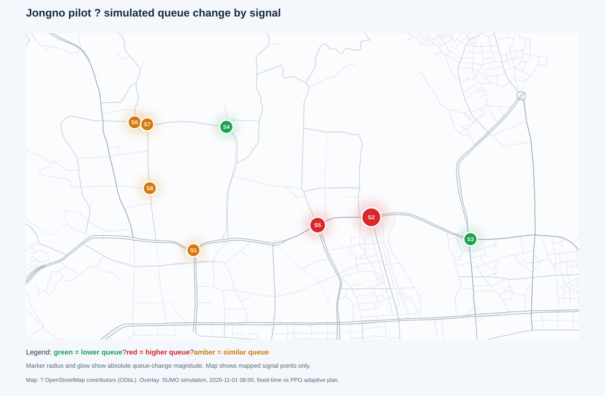

# Seoul Adaptive Signal Plan — Executive Evaluation

**Prepared:** 1 November 2026  
**Audience:** City leadership and transportation decision-makers  
**Decision requested:** Continue controlled development; do not adopt the adaptive plan for operational use based on this run.

## Executive summary

This prototype combines an OpenStreetMap (OSM) road network, SUMO traffic simulation, and a Proximal Policy Optimization (PPO) controller. It compares the generated fixed-time reference plan with an adaptive candidate across eight traffic signals in a 1.5 km Seoul subnetwork.

In the tested 15-minute scenario, the adaptive candidate performed worse on the principal congestion measures: mean queue increased from **2.48 to 6.90 vehicles** and mean waiting time increased from **39.2 to 394.6 seconds**. Average travel time also increased from **207.8 to 228.5 seconds**, while completed trips fell from **176 to 165**. These are simulated results under generated demand, not observations of Seoul traffic.

**Recommendation:** Keep the fixed-time reference for this test case. Treat the adaptive output as a research candidate that needs policy tuning and repeated evaluation before any operational decision. The value of this run is that the corrected measurements identify the specific junctions where the current policy needs attention.

## What changed in the dashboard

| Before | After |
|---|---|
| The Seoul testbed and its traffic-signal comparison were difficult for a general government user to navigate. Results and technical configuration competed for attention. | A guided workflow takes the user through the planning prompt, target date/time and demand assumptions, then a clear simulation-and-compare action. |
| The comparison was primarily presented as numerical or technical output, with little geographic context. | A map based on OSM roads places queue-change heat and signal markers at the simulated junctions. Marker details expose the before/after queue and waiting measures. |
| The intended decision—whether to retain or consider a proposed plan—was not prominent. | Fixed-time reference and adaptive candidate metrics are shown together, with a warning when the candidate regresses on a measure. The current and proposed phase states are available by signal. |

The map helps users locate changes; it does not indicate that the candidate is safe or suitable for field deployment. Dashboard scenario multipliers are planning assumptions. They should not be interpreted as measured traffic counts.

## Evaluation setup

| Item | Value |
|---|---|
| City and map | Seoul OSM-derived subnetwork, centered near 37.58408° N, 126.98828° E |
| Network extent | 1.5 km radius; eight simulated signal controllers |
| Scenario | 1 November 2026, 08:00; 900 seconds (15 minutes) |
| Day and profile | Sunday; morning-rush profile |
| Demand | SUMO `randomTrips.py`; effective insertion density 8.16 vehicles/hour/km; seed 42 |
| Controllers | SUMO generated fixed-time reference vs PPO deterministic policy |
| RL training | PPO, 2,048 training steps; joint signal action space; safety guard enforces signal clearance and green bounds |
| Event handling | A citywide autumn festival date range appears in scenario metadata, but no event-hour multiplier was applied at the target time |

The profile and event settings are scenario metadata and assumptions. They are not calibrated to observed 2026 traffic. The source currently integrated for Seoul T-Data dataset 1015 is an average-speed dataset, not a vehicle-volume count dataset.

## Before and after: simulated network results

| Measure | Fixed-time reference | Adaptive PPO | Change |
|---|---:|---:|---:|
| Mean total queue | 2.48 vehicles | 6.90 vehicles | **+178%** |
| Mean total waiting time | 39.2 s | 394.6 s | **+906%** |
| Average travel time | 207.8 s | 228.5 s | **+10.0%** |
| Completed vehicles | 176 | 165 | **−11 (−6.3%)** |
| Departed vehicles | 224 | 224 | No change |

Queue and waiting statistics are network-wide simulation averages over the 900-second run. Completed vehicles are trips that reached their destination during that run. Since the departed count was equal, the lower completion count indicates that fewer trips finished within the same simulation window under PPO.

### Geographic queue-change view

The map shows simulated signal locations over OSM roads. Red markers indicate a higher mean queue under PPO, green indicates a lower mean queue, and amber indicates little or no queue change. The marker intensity reflects queue-change magnitude. Use the dashboard’s interactive map to inspect junction details.



### Junction-level findings

| Signal | OSM/SUMO identifier | Mean queue: fixed → PPO | Mean wait: fixed → PPO | Assessment |
|---|---|---:|---:|---|
| S1 | `cluster_osm_11202819042_osm_11727528557_osm_1553878405_osm_8573300628_#2more` | 0.02 → 0.02 | 0.12 → 0.21 s | Nearly unchanged queue |
| S2 | `cluster_osm_13735062361_osm_436849195` | 1.28 → 4.41 | 19.03 → 284.45 s | Large regression; priority for investigation |
| S3 | `cluster_osm_414685953_osm_5194567135` | 0.25 → 0.17 | 4.52 → 3.52 s | Improved in this run |
| S4 | `osm_414686011` | 0.17 → 0.06 | 2.85 → 0.33 s | Improved in this run |
| S5 | `osm_436867523` | 0.69 → 2.14 | 11.45 → 104.58 s | Large regression; priority for investigation |
| S6 | `osm_436874335` | 0.00 → 0.00 | 0.00 → 0.00 s | No measured queue in this run |
| S7 | `osm_436883036` | 0.07 → 0.10 | 1.25 → 1.50 s | Small regression |
| S8 | `osm_6707984277` | 0.00 → 0.00 | 0.00 → 0.00 s | No measured queue in this run |

S2 and S5 account for the clearest adverse signal-level changes. S3 and S4 improved, but those local gains do not offset the network-wide deterioration. The zero values at S6 and S8 mean no queue/wait was recorded there in this particular run; they do not establish that those intersections have no real-world congestion.

## Decision and next steps

1. Retain the fixed-time reference as the comparison plan for this scenario.
2. Inspect PPO behavior at S2 and S5, including green allocation, action frequency, and spillback from adjacent links.
3. Evaluate policy changes over multiple random seeds and demand levels. Report distributions and worst-case junction outcomes, not only one-run averages.
4. Calibrate demand using appropriate observed vehicle-volume or turning-movement data. Average road speed alone cannot establish traffic counts or origin-destination flows.
5. Validate signal phasing and safety constraints against official intersection plans before presenting an operational recommendation.
6. Keep the dashboard recommendation explicitly labeled as simulated until field validation is completed.

## Interpretation and limitations

- This is a single run with one seed, one 1.5 km subnetwork, one 15-minute period, and generated trips. It is not a citywide evaluation.
- The demand density, rush-hour multipliers, directional weighting, and event impacts are assumptions unless explicitly linked to measured data. The comparison metadata states that the applied density is not an observed Seoul count.
- The OSM network and identified junction locations provide geographic context. OSM does not provide an authoritative live signal plan for every junction.
- The static reference phases are generated in SUMO and are not confirmed official government timings. The PPO plan is an adaptive controller behavior, not a published daily timing schedule.
- Averages can hide individual bad approaches, turn movements, or long-tail delay. No field deployment conclusion should be drawn from these values.
- An earlier run reported implausible zero adaptive queue/wait observations because controlled lane identifiers were treated as road-edge identifiers. That measurement mapping was corrected and the PPO model was retrained with a versioned model path. The results in this report use the corrected run; the earlier output is superseded.

## Reproducibility and references

Corrected comparison data: [`comparison.json`](../experiments/results/city_runs/CITY_RL_L01_42_20261101T130047/comparison.json). Per-signal time series are in the corresponding `rl_signal_state.csv` and baseline `traffic_state.csv` files referenced by that comparison record.

Launch the dashboard from the project virtual environment with:

```powershell
streamlit run scripts/dashboard.py
```

Sources and data context:

- [Seoul T-Data dataset 1015 — traffic speed data](https://t-data.seoul.go.kr/dataprovide/trafficdataviewopenapi.do?data_id=1015)
- [Seoul T-Data — traffic volume data catalog entry](https://t-data.seoul.go.kr/dataprovide/trafficdataviewfile.do?data_id=20004)
- [OpenStreetMap copyright and ODbL](https://www.openstreetmap.org/copyright)
